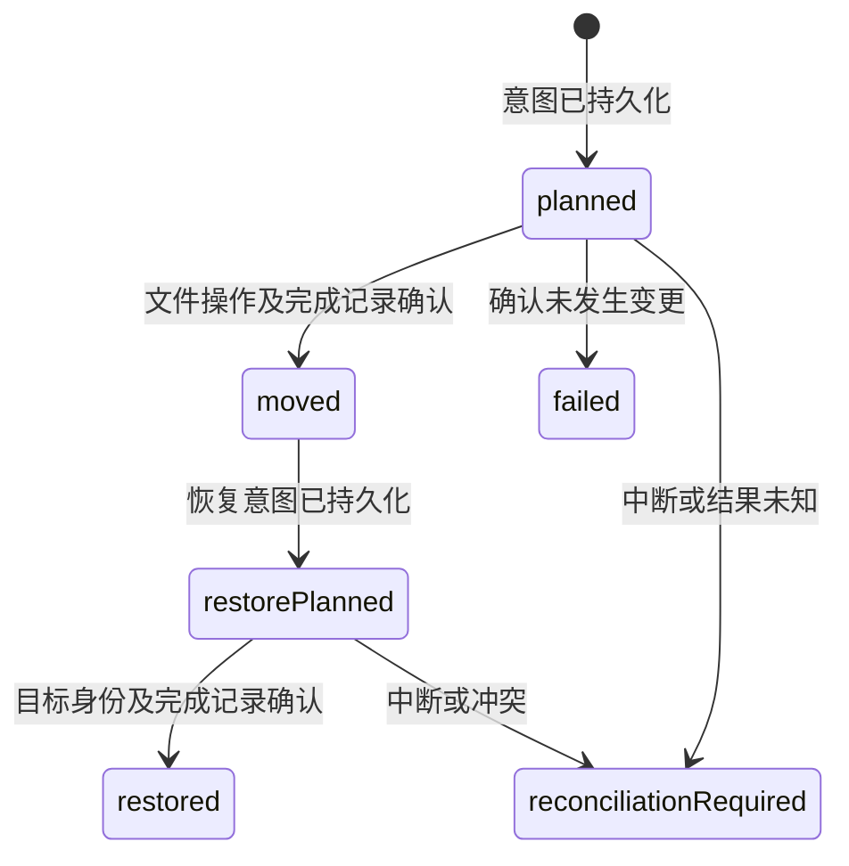

# Atlas 系统安全与恢复可信度改进方案

日期：2026-10-01。状态：**建议方案，尚未实现**。代码基线：`3716c48602a57d24ac2875989ad1beed53ee2405`。

依据：[安全审查报告](../../security_best_practices_report.md)。执行入口：[实现计划](../plans/2026-10-01-security-hardening.md)。本文覆盖 SEC-01～SEC-11，以及与这些问题直接相关的 Helper、路径、状态存储和 XPC 边界。

## 1. 目标与范围

用户要求分析可能使 Mac 不安全或崩溃的操作，并生成改进方案与实现计划。成功标准是：正常清理不会修改认证链、系统更新状态或有效服务；文件操作范围可解释；已经发生的部分变更有证据；无法恢复时如实显示；大目录、子进程和通信异常不会无限等待或触发已知计数崩溃。

本轮按以下假设设计：允许减少高风险功能；原生 GUI 优先保障恢复；保留遗留 CLI，但收窄永久删除范围；不新增常驻 root 服务；不以清理字节数作为安全性的替代指标。用户未要求实现代码，本次交付仅为方案和计划。

未发现足以证明 kernel panic 或无法开机的证据，本方案不把“修复应用崩溃”描述成“修复 macOS 内核”。不包含 LandingSite 全面 Web 审计、全依赖 CVE 审计、签名体系重建或新独立恢复仓库。

## 2. 方案选择

| 方案 | 收益 | 代价与局限 | 选择 |
| --- | --- | --- | --- |
| 先停用危险操作，再建立限定范围的执行与恢复记录 | 能先降低系统风险，后续每一层可独立验证 | 部分 CLI 清理、Touch ID 旧系统配置和服务残留清理会不可用 | **推荐** |
| 只修条件判断、增加路径字符串检查 | 改动小，短期功能回归少 | 不能解决检查后替换、进程中断、持久化失败、恢复误报 | 只用于第一阶段止损，不作为最终验收 |
| 引入全功能 root 服务与独立恢复仓库 | 能统一高权限能力和保留策略 | 增大提权攻击面，带来迁移、磁盘配额、授权与代码签名工程 | 本轮不采用 |

方案沿用 [ADR-001](../adr/ADR-001-Worker-and-Helper-Boundary.md) 的 Worker/Helper 分工及 [ADR-006](../adr/ADR-006-Fail-Closed-Execution-Capability.md) 的失败即关闭原则；调整 [ADR-007](../adr/ADR-007-Recovery-Retention-Enforcement.md) 的记录过期语义，并按 [ADR-008](../adr/ADR-008-Versioned-Workspace-State-and-Recovery-Payload-Compatibility.md) 演进状态版本。

## 3. 全局约束

- 原生最低版本保持 macOS 14；SPM 保持 Swift tools 5.10，Xcode 保持 Swift 6.0；Go 保持 `go.mod` 的 1.25.0，不新增第三方依赖。
- Helper 保持普通用户权限；自动清理不执行 root 永久删除；不提供绕过安全拒绝的 `--unsafe` 或环境开关。
- 保护对象：PAM、系统更新目录、LaunchAgents/LaunchDaemons、PrivilegedHelperTools、应用/文档包内部、未选择文件、已有恢复记录。
- 未知、查询失败、权限不足、路径身份变化分别产生明确结果；未知状态不能转换成“安全”“不存在”或“成功”。
- 写操作必须绑定已展示计划和明确选中项；空选择、未知 ID、重复 ID、旧计划不扩大操作集合；任何实际移动前再次验证。
- 同一工作区同时只有一个变更批次；执行、恢复、迁移和记录清理共用跨进程锁。
- 生产测试不修改真实 PAM、路由、蓝牙、用户废纸篓或服务；真实系统操作只在可回滚的测试虚拟机执行。
- 中文和英文文案同时维护；需要时执行 copy、README 媒体和真实 UI 门禁；`swift test` 不替代 XCUITest。

## 4. CLI：先移除破坏性默认行为

| 行为 | 第一阶段 | 后续允许范围 |
| --- | --- | --- |
| 修改 Touch ID/PAM | `status`、预览可用，修改拒绝 | 仅经过 VM 验收的 macOS 14+ `sudo_local` 事务；主 `sudo` 文件和旧系统配置保持只读 |
| `safe_sudo_remove` | 统一拒绝，删除统计不增加 | 本轮不恢复通用 root 删除 |
| `safe_remove` | 数据删除暂停；独立保留本进程创建的临时文件回收 | 经目录描述符约束的用户缓存删除；无后端时拒绝，无 `rm -rf` 回退 |
| `/Library/Updates`、`/macOS Install Data` | 只报告，由系统管理 | 不进入自动清理 |
| 服务/HelperTools 残留 | 只报告“需要核对” | 本轮不自动卸载、删除；修正解析仅改善报告 |
| 刷新全局路由、ARP、重启蓝牙、泛化权限修复 | 从自动优化和建议执行列表移除 | 单独故障排查产品另行设计，本轮不保留暗含确认的执行入口 |
| 清空废纸篓 | 从常规清理移除，包括 Finder 和 `rm` 回退 | 本轮不新增永久清空入口 |
| CLI 卸载、purge 等不在缓存范围的删除 | 执行前拒绝并说明原因 | 不得先停止应用/卸载服务再发现不能删除；GUI 受控卸载独立验收 |

变更在执行函数落实，不能只修改菜单、默认白名单或 `safe=true`；旧配置与直接函数调用也不能恢复危险行为。卸载、优化、autofix 中的同类旁路纳入调用点清单。

### 4.1 PAM 事务

新增单一 PAM 写入模块，所有 Touch ID/autofix 修改入口只能使用它。第一版只支持标准 `/etc/pam.d/sudo` 已包含 `sudo_local` 的 macOS 14+ 配置；不自动改主文件，不根据未知企业/MDM 规则猜测迁移。不安全或非标准现状只诊断，不能将可能已被用户修改的策略直接提升为可信 root 策略。

一次 sudo 会话完成：固定操作枚举 → 校验受信任父目录及原文件类型/属主/链接数 → root 专用备份 → 同目录暂存 → 内容校验 → 设置 `root:wheel`、`0444` → 原子替换 → 验证。任何失败均在该会话内回滚或明确报告“需要人工修复”；不依赖下一次 sudo 才设置正确权限。拒绝符号链接、非普通文件、多硬链接、任意输出路径和任意 shell 文本。停用 Touch ID 后无其他内容的 `sudo_local` 可安全移除；有其他配置则保留原有内容及顺序。

VM 验证必须包含下一次 sudo 认证、原始配置恢复、错误注入和 owner/mode；Shell mock 只证明命令顺序，不能证明 PAM 可用。该阶段失败时功能保持停用。

### 4.2 CLI 文件删除边界

新增小型普通权限 Go 程序 `safe-remove`，Shell 仅传 JSON 请求，不再构造 shell 删除命令。v1 生产 scope 只有 `userCaches`，固定指向当前账户的 `~/Library/Caches`；不接受调用者自定义根目录，拒绝 euid 0，拒绝缓存根目录本身。`HOME` 环境变量不决定权限范围。测试通过内部依赖注入建立临时根，不对发行二进制开放任意测试根参数。

实现采用 Darwin 目录描述符操作：从可信账户主目录逐组件 `openat` 且拒绝链接，固定缓存根描述符；相对路径不能含空组件、`.`、`..`、NUL；递归时不跟随链接，不跨文件系统，针对已打开目录使用 `unlinkat`。检查计划捕获的身份与执行时对象，不一致则拒绝。拒绝 FIFO/socket/device 等对象；路径中空格、中文和换行必须完整经 JSON 保留。

Go 的 `os.Root` 提供防越界能力，但会允许根内部的符号链接，并不自动排除挂载点；因此不能用一次 `realpath`，也不能仅换成 `Root.RemoveAll` 就宣称符合这里更窄的策略。参考 [Go 官方介绍](https://go.dev/blog/osroot) 和 [Go 1.25 Root 文档](https://pkg.go.dev/os@go1.25.0#Root)。

承诺范围是所持有的授权目录对象和子项，不是防御同 UID 恶意进程对全部用户文件的任意修改；同 UID 攻击者本就拥有这些文件权限。对并发移动、替换和部分删除如实记录，不能宣称多文件永久删除是原子的。边界竞争测试失败则不恢复此功能。进程自己的临时目录另走内部登记与清理接口，不扩大到整个 `/tmp`。

## 5. 原生操作：按动作定义路径与对象

新增 `AtlasFileSafety` 共享模块，Domain 放可序列化的文件身份/动作类型，Safety 放 macOS 文件类型检查与具体策略；Worker 和普通 Helper 使用同一策略。扫描器只提出候选，不授予执行权。

| 动作 | 允许对象 | 拒绝对象 |
| --- | --- | --- |
| 整理 | 用户明确选择的主目录内普通文件夹中的普通文件；目标为主目录内明确整理目录 | 主目录本身、`~/Library`、`~/Applications`、废纸篓/Atlas 状态目录、系统/其他卷、包内部、链接和未知类型 |
| 智能清理 | `~/Library/Caches`、`~/Library/Logs` 下经规则识别并选中的具体后代 | 根目录本身；字符串名称恰好含 cache/log；任何其他默认范围 |
| 应用卸载 | 应用清单中定位且被明确选中的完整第三方 `.app`；精确核对的用户缓存/日志 | Apple/系统应用、包内部、运行中应用未经退出确认、根据名字推断的服务或共享数据目录 |
| 恢复 | 本地操作记录中来源明确的映射，目标无冲突；旧记录另走兼容判定 | 请求方自由指定路径、冲突覆盖、仅因目标同名存在就报告成功 |
| removeLaunchService / repairOwnership | 无 | 本轮 Helper 执行端直接拒绝 |

应用卸载的独立应用清单可以授权 `/Applications` 和 `~/Applications` 内完整包，不能复用成“整理来源”权限。应用关联的 Application Support/容器数据先显示为人工检查项，不用模糊名称自动删除。

扫描配置 `.skipsPackageDescendants`，同时读取包元数据，并保护 `.app/.framework/.bundle/.photoslibrary/.photolibrary/.pages/.numbers/.key` 等已知包。扫描根本身位于包内部时也拒绝；枚举异常显示未完整扫描，不默默当作无文件。目的地不得位于任一来源根之内，避免重扫已整理结果。

已存在的 Swift URL 路径检查应统一到此模块。执行前验证祖先、文件身份及目的父目录；整理和普通恢复使用目录描述符及“不覆盖目标”的移动。Finder Trash API 仍有路径形式调用窗口，不能声称对主动同 UID 替换实现了内核级原子授权；该残余风险单独记录，若未来必须覆盖这类对手，需要专门的暂存区/原子移动设计。

## 6. 计划规模、身份与选择

`ActionPlan.id` 保留 UUID；移除 `UInt16(entries.count)` 和靠截断/XOR 构造身份。Worker 保存完整计划及 SHA-256 摘要，摘要绑定 schema、策略版本、动作、排序后的条目 ID、源/目的路径、文件身份；不能只对数量摘要。跨 XPC 传输计划引用后，执行端从本地计划记录加载并核对，不信任客户端补写路径。

建议产品上限：一次扫描 **100,000** 个候选，一次变更批次最多 **1,000** 个选中项。达到 100,001 时返回明确超限错误，不生成可执行的静默截断结果；大计划只可显式选择不超过 1,000 项并重新验证，不自动拆批扩大操作。内存测试覆盖 65,535、65,536、100,000，不创建同量级真实文件。字节汇总采用检查型运算，溢出返回错误。

## 7. 逐文件证据与恢复

### 7.1 先补立即丢失，再补跨崩溃保障

首先修正同一 Finding 中 A 成功、B 失败时 A 的恢复映射丢失，以及 `persistState` 吞掉错误。这个小修复只能减少已知窗口，**不满足最终恢复验收**。

随后新增逐文件操作日志：计划和选择落盘 → 写 `planned` 并同步 → 执行单文件变更 → 写 `moved` 与真实返回路径/身份并同步 → 投影到工作区快照。每次文件操作独立记账。追加失败时立即停止后续变更，返回可见的部分完成/需核对状态。日志是证据源，快照是可重建视图。

每条记录包括：`journalVersion=1`、单调序号、校验信息、`operationID`、`requestID`、`planID`、计划摘要、策略版本、动作、Finding/entry ID、源/目的路径及文件身份、时间、状态及错误码。日志目录 `0700`、文件 `0600`；拒绝链接；写入使用校验长度的记录帧、完整写入和同步，不只依赖 JSON 文件的 `.atomic`。截断尾记录保留证据，进入核对模式，不能悄悄丢弃后继续执行。

Finder 返回真实废纸篓路径之后、日志写入之前仍有崩溃窗口。无法证明结果的条目进入 `reconciliationRequired`，提供源路径和时间用于核对，不扫描废纸篓后仅凭文件名猜测成功。多文件操作不承诺全有全无，也不自动回滚已成功项覆盖新文件。

### 7.2 并发、重复请求与持久化

Worker actor 不能代替变更互斥：`await` 会重入，Direct Worker 与 XPC Worker 也可能各有实例。引入批次租约和工作区文件锁；锁持有覆盖日志、文件变更和快照提交。进程退出释放锁，重启首先核对未完成日志。Helper 执行失败或通信超时后的结果均可能未知，调用方不得自动重试变更。

同一 `requestID` + 相同计划/选择重复提交，只返回已有结果或“需核对”；同 ID 不同内容拒绝。取消只阻止新的文件操作，已经启动的文件操作等待其有界结果并保存证据，不抹去部分成功。

状态 schema 从 1 升为 2；旧映射新增可选 `operationID` 和文件身份，解码旧记录不捏造凭据。迁移先保留只读备份，在同一工作区锁内完成；损坏/未来版本状态进入只读错误状态，不用示例快照覆盖原文件。恢复错误与未核对项不因保留期限自动消失；过期可以停止普通一键恢复，但须保留审计记录，且绝不连带永久删除物理来源。

### 7.3 恢复结果必须可证明

| 废纸篓/整理来源 | 目标 | 结果 |
| --- | --- | --- |
| 存在且身份匹配 | 不存在 | 记录恢复意图，执行无覆盖移动，核对身份后记为恢复 |
| 存在 | 已存在 | `targetConflict`，两边不改，不计成功 |
| 不存在 | 已存在 | 仅“已持久化 restored 凭据 + 目标身份匹配”可算幂等成功；否则 `sourceMissing`/需核对 |
| 不存在 | 不存在 | `sourceMissing`，保留证据 |
| 任一路径身份改变或无法读取 | 任意 | 拒绝或需核对，不猜测 |

旧记录没有身份时只允许来源仍存在、目标空缺、路径策略通过后的显式兼容恢复；显示凭据不足，不采用同名幂等成功。文件身份以卷/设备、inode 和创建时间等本机证据组合，不能宣称跨卷复制后身份保持；第一版不自动恢复跨卷移动。

UI 分开显示“已完成”“部分完成”“未执行”“需要核对”“来源已丢失”，只累计有凭据的实际成功项。恢复期限描述为记录期限和尽力恢复，废纸篓可被 Finder/其他软件清空，不能继续保证物理文件一定保留。

## 8. 子进程与 XPC

新增无业务依赖的 `AtlasProcessSupport`，由 Infrastructure/CoreAdapters 共用：参数数组启动，持续并发读 stdout/stderr，异步写 stdin；超时/取消覆盖启动、写输入、等待退出和读取 EOF。一次完成锁防止退出、错误、取消同时恢复 continuation。

默认预算：Helper **30 秒**、Health **15 秒**、Smart Clean 扫描 **120 秒**；TERM 宽限 **1 秒**，超出后 KILL；stdout 上限 **8 MiB**、stderr 上限 **1 MiB**。输出超限明确失败并清理进程，不截断为可解析成功。使用本次启动独有的进程组，仅结束拥有的进程；不得 `pkill` 名称匹配其他实例。父进程退出但后代持有管道时同样有界结束，逃离进程组的后代作为明确的实现限制。

XPC 单次请求使用可取消、至多完成一次的状态对象；超时清理回调并失效连接。自动重试只允许纯读取；执行/恢复/设置写入等请求超时后返回未知结果并查询原 requestID。不要因为客户端返回超时就推断服务端没有执行。

Release Helper 只从签名 bundle 的确定位置解析；测试通过构造函数注入，开发环境覆盖限 Debug。保持嵌入式普通 XPC service，不扩成全局 Mach/root 服务；若以后改变部署方式，需另做调用者身份与授权设计。

## 9. 验收与发布

分为 P0 止损、P1 原生恢复可信、P2 有限功能重开与发布三道门，详见实现总计划。任何一项高风险功能重新开放都要有负向测试和对正常场景的正向测试；只“报错了”不够，测试还须断言受保护文件/服务配置/未选项保持完整。

Shell 原件及 `Resources/MoleRuntime` 必须有单向同步和只读一致性检查，CI 发现漂移即失败；新增 Go 二进制必须覆盖安装、两种架构资产和打包，缺失时拒绝删除。严格检查门禁输出：缺依赖、零测试、跳过不是通过。新门禁接入前保存 workflow 历史与首次实际执行证据。

系统级验收在可回滚 VM 进行，特别是 PAM 和全量 acceptance 的安装步骤。普通开发机只做临时目录、mock、只读扫描和受控子进程测试。回退版本不能重新启用已知危险操作；schema 2 已有新操作时禁止把旧 schema 1 快照覆盖回来，优先关闭写功能并前向修复。

## 10. 剩余边界

- 使用 Finder 废纸篓仍是尽力恢复；没有独立仓库就没有独占保留期保证。
- 本机文件系统与日志不构成一个事务；未知结果必须人工或有证据的核对。
- 一般文件身份与检查不能防御拥有相同 UID 的任意恶意进程；不将此轮加固宣传成对所有本机攻击的隔离。
- 文件系统/存储设备故障、突然断电可能超出进程崩溃测试覆盖；日志同步不能当作硬件不会丢数据的承诺。
- 功能范围缩小是可见产品变化，发布说明必须列出，不能把安全跳过计作清理成功。

除 Go 边界文档外，平台语义沿用审查所引的一手资料：[Apple OpenPAM](https://github.com/apple-oss-distributions/OpenPAM/blob/main/openpam/lib/openpam_configure.c)、[launchd.plist](https://github.com/apple-oss-distributions/launchd/blob/main/man/launchd.plist.5)、[route](https://github.com/apple-oss-distributions/network_cmds/blob/main/route.tproj/route.8)、[Swift TaskGroup](https://docs.swift.org/latest/documentation/swift/taskgroup/)。
