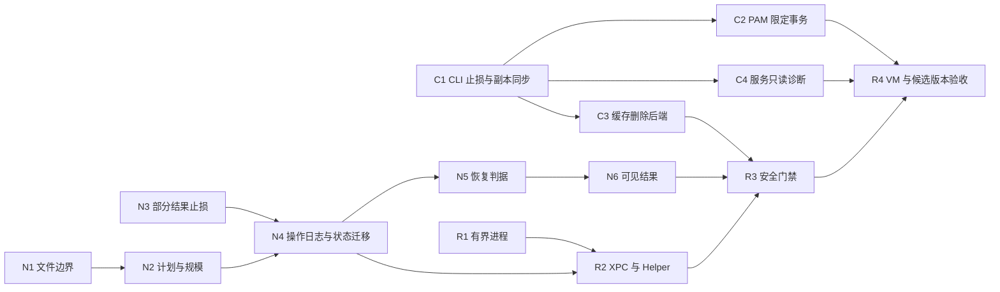

# Atlas Security Hardening Implementation Plan

> **For agentic workers:** REQUIRED SUB-SKILL: Use `superpowers:executing-plans` to implement this plan task-by-task. Steps use checkbox (`- [ ]`) syntax for tracking. 用户已要求按计划实现；真实系统操作、功能重开与发布仍遵守验收边界。

**Goal:** 关闭审查中的 11 类已知风险，使 Mac 系统操作默认保守、文件变更可核对、恢复结果可信。

**Architecture:** 先收缩危险能力，再建立普通权限文件执行边界、逐文件日志和有界进程通信。保留现有 GUI/Worker/Helper 分层，不增加常驻 root 服务。

**Tech Stack:** macOS 14+、Swift tools 5.10 / Xcode Swift 6.0、Foundation/Darwin、Go 1.25.0、Bats、XCTest/XCUITest。

**Spec:** [改进方案](../design/2026-10-01-security-hardening.md)。基线：`3716c48602a57d24ac2875989ad1beed53ee2405`。

## Global Constraints

- Helper 保持普通用户权限；自动清理不执行 root 永久删除；不提供绕过安全拒绝的 `--unsafe` 或环境开关。
- 原生最低版本保持 macOS 14；SPM 保持 Swift tools 5.10，Xcode 保持 Swift 6.0；Go 保持 `go.mod` 的 1.25.0，不新增第三方依赖。
- 一次扫描最多 100,000 候选，一次变更批次最多 1,000 个选中项；超限拒绝，不静默截断或自动分批。
- Helper/Health/Smart Clean 超时分别为 30/15/120 秒，TERM 宽限 1 秒，stdout/stderr 上限为 8/1 MiB。
- 生产测试不修改真实 PAM、路由、蓝牙、用户废纸篓或服务；真实系统操作只在可回滚的测试虚拟机执行。
- 实施状态更新于 2026-10-04：C1–C4、N1–N6、R1–R3 的代码已实施并隔离验证；R4 的 VM/签名安装/真实 Direct-XPC 端到端/新 CI 实跑尚未完成，所有高危能力保持关闭。详见 [验收表](../security/2026-10-01-release-acceptance.md)。

## Review Focus

1. 旧配置或直接函数调用绕开菜单保护：C1 断言后端完全没有系统副作用。
2. 扫描后目录被换成链接：C3/N1 断言范围外哨兵及未选文件保持完整。
3. 移动成功后磁盘满或崩溃：N3/N4 断言部分成功保留、未知结果显式核对、后续文件不移动。
4. 重复请求、重复点击与两进程并发：N4/R2 断言最多一次文件操作，超时不自动重试变更。
5. 旧版/损坏状态和旧打包副本：N4/R3/R4 断言原始证据不覆盖，门禁实际执行且能验红。

## 1. 子计划与依赖

| 子计划 | 任务 | 主要产物 |
| --- | --- | --- |
| [CLI 系统操作](2026-10-01-security-cli-hardening.md) | C1～C4 | 关闭危险默认值、PAM 事务、目录描述符删除、服务只读诊断 |
| [原生文件操作与恢复](2026-10-01-security-native-recovery.md) | N1～N6 | 类型化策略、计划约束、部分结果、操作日志、真实恢复、用户界面 |
| [进程、通信与验收](2026-10-01-security-runtime-and-acceptance.md) | R1～R4 | 进程执行器、XPC 完成与重试策略、门禁、候选版本验收 |

图表示代码依赖，不表示必须使用多个 agent。默认顺序执行；可以分独立 PR，不合并尚未通过本阶段验收的功能重开。

## 2. 分阶段交付

### P0：止损版本

- [x] C1：关闭 PAM 修改、通用 CLI 删除、系统更新/服务/网络蓝牙/废纸篓自动操作，并同步内嵌脚本。
- [x] N1：阻断包内部与危险来源，Helper 拒绝未支持动作；执行端验证确实覆盖绕过扫描器的输入。
- [x] N2：移除 65,536 条目崩溃点，约束计划身份及选中集合。
- [x] N3：保留同 Finding 已完成映射，持久化失败可见且停止后续操作。
- [x] R1：修复子进程超时与管道等待；R2 的“一次完成 + 变更不重试”可先独立落地，查询日志部分在 N4 后完成。

**退出条件：** 每项新增回归先验红再通过；安全关闭不被旧配置/直接调用绕过；受保护哨兵不变。P0 不能宣传“崩溃后完整恢复”。若要先发 P0，未具备 N4 日志的原生批量清理/整理/恢复入口保持关闭，仅允许扫描和预览；关闭同时落实到 Worker，不能只禁用按钮。

### P1：原生恢复可信版本

- [x] N4：日志、互斥、请求去重、状态迁移与启动核对。
- [x] N5：恢复来源缺失、同名目标、幂等恢复的严格判据。
- [x] N6：真实部分结果、需核对与来源丢失界面；更新双语文案与实际 UI 测试。
- [x] R2：连通 requestID 状态查询、无自动变更重试及 Release Helper 路径约束。

**退出条件：** 在计划写入、移动、完成记录、快照保存等故障点中断再重启，已有事实不丢失，无法证明的结果不计成功；损坏状态不覆盖；两 Worker 只执行一次。满足后才重新开启受限的原生变更能力。

### P2：有限 CLI 重开与发布

- [ ] C2：VM 中验证 PAM 事务；不支持的系统/企业配置继续只读。
- [ ] C3：普通权限缓存删除、安装及双架构产物齐全；边界竞争测试通过后才重新接入。
- [x] C4：修正服务解释，不恢复自动服务删除。
- [ ] R3：安全门禁、资源副本一致性、测试数/跳过识别与 workflow 实跑证据。
- [ ] R4：VM 系统验证、原生 Swift 两种语言模式、实际 UI、打包安装和恢复矩阵。

**退出条件：** 所有高风险发现都有“消除或受后端关闭”的证据；中风险测试通过；明确记录尚未恢复功能与剩余边界。C2/C3 任一个失败不阻塞更安全的只读版本，但该功能不得重开。

## 3. 发现到任务的追踪

| 发现 | 立即措施 | 完整修复 | 关键验收 |
| --- | --- | --- | --- |
| SEC-01 PAM 权限 | C1 | C2、R4 | root:wheel/0444、失败回滚、下一次 sudo 可用 |
| SEC-02 删除越界 | C1 | C3、R3 | 重复斜线/父级链接/竞争替换均不触碰范围外哨兵 |
| SEC-03 拆散包 | N1 | N1、N2 | 递归与伪造执行请求都不能移动包内部 |
| SEC-04 恢复记录丢失 | N3 | N4、N6、R2 | A 成功 B 失败；ENOSPC；崩溃窗口；重启核对 |
| SEC-05 更新暂存删除 | C1 | C1、R4 | 旧配置下也不写更新目录 |
| SEC-06 服务误删 | C1 | C4、R4 | Program 优先；所有候选只读 |
| SEC-07 网络/蓝牙重置 | C1 | C1、R4 | 检测失败和 --yes 均不刷新路由或停止服务 |
| SEC-08 清空废纸篓 | C1 | C1、N5、N6 | 无 Finder empty trash/永久删除；源丢失明确可见 |
| SEC-09 等待/超时 | R1 | R1、R2 | 大输出、忽略 TERM、无回复、管道不关闭都能有界结束 |
| SEC-10 恢复误报 | N3 的保守拒绝 | N5、N6 | 同名新文件不算原文件恢复 |
| SEC-11 UInt16 崩溃 | N2 | N2 | 65,536 正常构造；100,001 明确超限 |
| 相关 Helper/路径/XPC 边界 | N1 | N1、N2、R2 | 动作分别限域，根目录拒绝，变更无自动重试 |

## 4. 实施前与验收证据

- [x] 记录当时 `git status --short`、HEAD、系统/Xcode/Swift/Go 版本；保留已有用户改动。基线变化时核对本计划中的函数和路径。
- [x] 使用隔离分支/工作树；先运行拟修改模块的现有测试，区分既有失败与新回归。创建工作树不等于安装/运行 App。
- [x] 每个任务保留回归失败与通过结果、受保护哨兵断言、实际测试数。测试缺依赖必须记为未执行，不能列为通过。
- [x] 每任务完成代码审查和独立提交；不自动 push、merge 或发布。C1 起维护 `Docs/security/2026-10-01-hardening-evidence.md` 记录提交、命令、结果、限制与日志位置，不收入用户私有文件内容。
- [x] R4 汇总 SEC-01～SEC-11 逐项状态。没有实测的风险缓解标为“静态/隔离验证”或“功能已关闭”，不标成真实系统验证通过。

## 5. 回滚与范围控制

优先回滚单个新后端到“拒绝写操作”，不回到旧版危险删除/PAM 逻辑。schema 迁移保留备份用于诊断，但有新操作后不得恢复旧快照丢弃日志；旧客户端遇新 schema 应停止写入。无法保证旧版自行拒绝时，禁止就地降级，保留数据并前向修复。

不在这批 PR 中加入独立恢复仓库、常驻 root Helper、远程控制或新优化动作；不顺带重构整份 Worker。只将文件策略、计划、日志、执行互斥和进程执行抽成可独立测试的模块。

## 6. 本次文档自检

本计划以三个子计划作为任务定义；所有 11 个发现有归属，五类 Review Focus 已分配测试；CLI 安装资产、内嵌脚本、Swift 6、状态向后兼容、真实 UI 和 VM 系统验收均在范围内。原始计划阶段未声称产品测试通过。实施后的实测数量、关闭能力和未验收项以验收表与 evidence 为准，不据本计划复选框自动重开功能。

## 7. 实施结论（2026-10-04）

本次完成关闭能力候选的代码与本地验收，未完成 P1/P2 的功能重开或 R4 全量发布验收。C2 事务库、C3 缓存后端和 R3 门禁代码完成，但对应 VM/安装/新 workflow 实跑复选框继续保留未完成。CLI 与原生恢复分别成批提交：共享协议/日志/投影依赖保持同批，避免将半套恢复事务提交为可运行候选。最终独立审查发现的旁路和误报已追加修正。详细日志见验收表；不自动 push、合并或发布。
